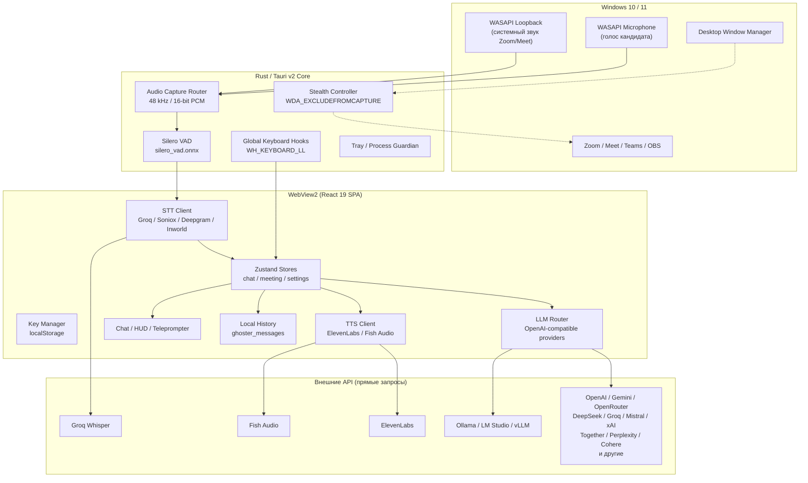
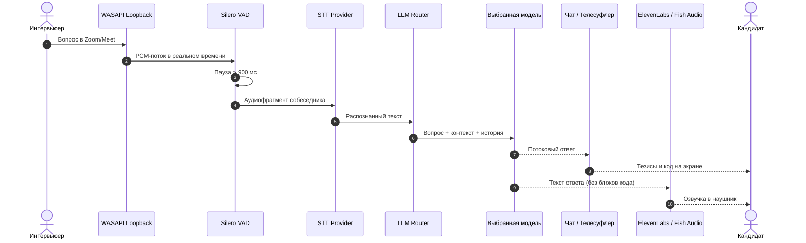
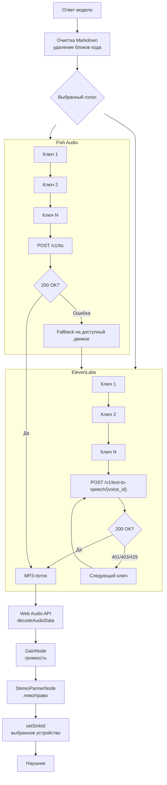
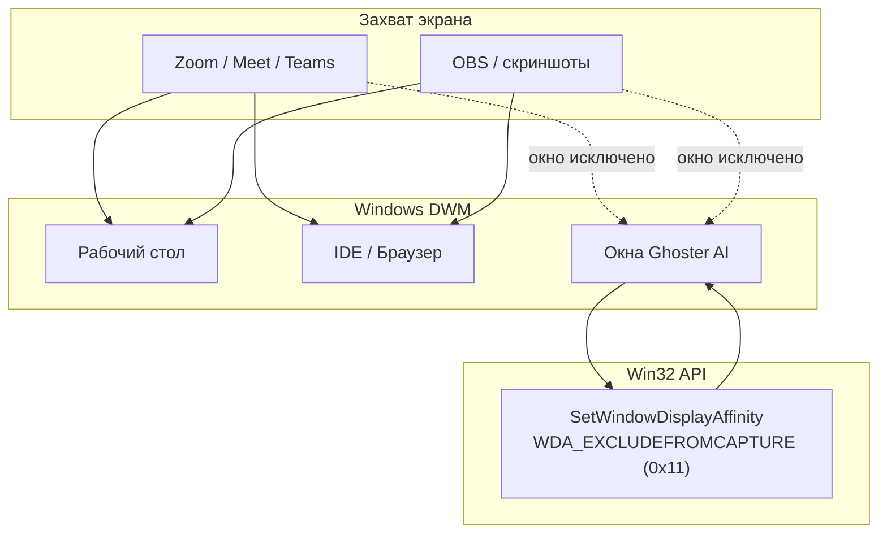
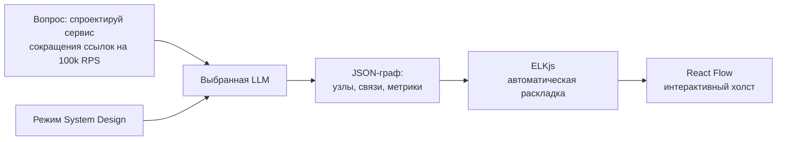

# Ghoster AI Desktop — локальная сборка (v3.3.5)

<div align="center">


### Автономный ИИ-ассистент для собеседований, алгоритмических секций, System Design и лайвкодинга

*Свои API-ключи • Локальная история • Прямые запросы к провайдерам • Windows x64*

</div>

---

> **Ключи добавляются вручную** в окне **API** и хранятся в локальном профиле
> WebView2. Приложение работает как локальный клиент: запросы уходят напрямую
> выбранному провайдеру.

---

## Оглавление

1. [Архитектура и ключевые возможности](#1-архитектура-и-ключевые-возможности)
2. [Интерактивные диаграммы работы системы](#2-интерактивные-диаграммы-работы-системы)
   - [Общая архитектура](#21-общая-архитектура)
   - [Конвейер автоматического ответа](#22-конвейер-автоматического-ответа)
   - [Движок синтеза речи](#23-движок-синтеза-речи)
   - [Защита от захвата экрана](#24-защита-от-захвата-экрана)
3. [Как работает автоответ на вопросы](#3-как-работает-автоответ-на-вопросы)
4. [Синтез речи: ElevenLabs и Fish Audio](#4-синтез-речи-elevenlabs-и-fish-audio)
5. [Распознавание речи: Groq Whisper и другие STT](#5-распознавание-речи-groq-whisper-и-другие-stt)
6. [LLM, менеджер ключей и провайдеры](#6-llm-менеджер-ключей-и-провайдеры)
7. [Режим System Design](#7-режим-system-design)
8. [Режим маскировки (Disguise Engine)](#8-режим-маскировки-disguise-engine)
9. [Телесуфлёр и защита от обнаружения](#9-телесуфлёр-и-защита-от-обнаружения)
10. [Горячие клавиши](#10-горячие-клавиши)
11. [Локальная история и аналитика](#11-локальная-история-и-аналитика)
12. [Структура репозитория и релиза](#12-структура-репозитория-и-релиза)
13. [Установка, настройка и сборка](#13-установка-настройка-и-сборка)
14. [Безопасность, лицензии и ограничения](#14-безопасность-лицензии-и-ограничения)
15. [Troubleshooting](#15-troubleshooting)

---

## 1. Архитектура и ключевые возможности

**Ghoster AI Desktop (v3.3.5)** — десктопное приложение для Windows x64 на
гибридном ядре **Rust (Tauri v2)** и **React 19 / Tailwind CSS**. Интерфейс
работает в WebView2, аудио и глобальные горячие клавиши — в нативном ядре.

Ключи добавляются пользователем в менеджере; провайдер и модель выбираются
вручную.

### Основные функции

- **Автоответ на вопросы собеседника (Hands-Free Auto-Answer)**: захват
  системного звука, локальная VAD-детекция паузы, распознавание речи, генерация
  ответа выбранной моделью и вывод в чат/телесуфлёр.
- **Невидимость при демонстрации экрана**: окна чата, HUD и телесуфлёра
  исключаются из видеопотока через Win32
  `SetWindowDisplayAffinity(hwnd, WDA_EXCLUDEFROMCAPTURE)`. Работает в Zoom,
  Google Meet, Microsoft Teams, Discord, OBS и других программах захвата.
- **Маскировка (Disguise Engine)**: пресеты популярных приложений, режим
  «Пустота», своё имя/иконка, синхронизация заголовков окон и процессов
  WebView2.
- **System Design**: интерактивный холст на React Flow + ELKjs; модель
  генерирует компоненты, связи, схемы БД и расчёты нагрузки.
- **Мультимодельный селектор**: переключение моделей без потери контекста;
  список зависит от выбранного провайдера и доступных ключей.
- **Режим сквозного клика (Pass-Through)**: можно работать в IDE сквозь
  полупрозрачный телесуфлёр.
- **TTS**: ElevenLabs и Fish Audio, стереопанорама, выбор устройства вывода,
  пропуск блоков кода при озвучке.
- **Мультимодальный анализ экрана**: снимок области или всего экрана с
  передачей изображения модели.
- **Локальная история**: сообщения и встречи сохраняются в `localStorage`
  профиля WebView2.
- **Свой OpenAI-совместимый провайдер**: произвольный URL, модели и ключи;
  подходит для LiteLLM, OpenWebUI, корпоративных шлюзов и llama.cpp server.
- **Локальные модели**: Ollama, LM Studio и vLLM через отдельный чекбокс
  «использовать локальный сервер».

---

## 2. Интерактивные диаграммы работы системы

### 2.1. Общая архитектура



### 2.2. Конвейер автоматического ответа



### 2.3. Движок синтеза речи



### 2.4. Защита от захвата экрана



---

## 3. Как работает автоответ на вопросы

1. **Раздельный захват аудио**
   - Системный звук захватывается через `WASAPI Loopback Capture` — это речь
     собеседника из Zoom/Meet/Teams.
   - Микрофон кандидата захватывается отдельно.
   - Каждому фрагменту присваивается источник: `system` или `microphone`.

2. **Локальная VAD-детекция**
   - `silero_vad.onnx` обрабатывает аудио локально до отправки выбранному
     STT-провайдеру.
   - Когда собеседник заканчивает вопрос и наступает тишина (обычно > 900 мс),
     фрагмент финализируется.

3. **Распознавание речи**
   - Аудио отправляется выбранному STT-провайдеру с вашим ключом.
   - Поддерживаются Groq Whisper, Soniox, Deepgram и Inworld (в зависимости от
     настроек и доступных ключей).
   - Встроенный дедупликатор отсекает повторные чанки и эхо микрофона.

4. **Генерация ответа**
   - Текст вопроса, история последних реплик и контекст из раздела
     **«Контексты»** передаются выбранной LLM.
   - Провайдер и модель выбираются в селекторе; ключ берётся из локального
     менеджера.
   - При ошибке `401/403/404` приложение переключается на следующий ключ того
     же провайдера, если он добавлен.

5. **Вывод**
   - Ответ печатается в чат и, при включении, в телесуфлёр.
   - При автоозвучке текст уходит в ElevenLabs или Fish Audio.

---

## 4. Синтез речи: ElevenLabs и Fish Audio

TTS — отдельный слой: он не участвует в маршрутизации чата и не попадает в
список LLM-провайдеров.

### Возможности

- **ElevenLabs**: выбор голоса, стриминг MP3, несколько ключей с ротацией.
- **Fish Audio**: выбор голоса, `reference_id`, MP3, fallback при ошибке.
- **Стереопанорама**: звук можно направить в левый или правый наушник.
- **Выбор устройства вывода**: `setSinkId` в Web Audio API.
- **Скорость и громкость**: регулируются в настройках.
- **Пропуск кода**: Markdown-блоки кода вырезаются перед озвучкой.

### Ключи

Добавьте ключи ElevenLabs и/или Fish Audio в окне **API → Провайдеры**. Это
TTS-пресеты: они не появляются в списке моделей чата. Без ключа TTS просто не
запустится; чат продолжит работать.

---

## 5. Распознавание речи: Groq Whisper и другие STT

- **Groq Whisper Large v3 Turbo** — основной быстрый вариант; ключ Groq
  добавляется в менеджере.
- **Soniox / Deepgram / Inworld** — альтернативные STT-провайдеры, если
  соответствующие ключи добавлены и модуль выбран в настройках.
- **Язык**: русский с поддержкой английских технических терминов.
- **Ротация ключей**: при `429`/`401` приложение пытается использовать
  следующий ключ провайдера.
- **Локальная VAD**: Silero VAD работает на компьютере; выбранному
  STT-провайдеру отправляется только финальный фрагмент.

---

## 6. LLM, менеджер ключей и провайдеры

### Менеджер ключей

Менеджер открывается кнопкой **API** в правом нижнем углу или баннером
«API-ключи не настроены».

- Поиск и категории провайдеров.
- Несколько ключей на одного провайдера.
- Маскирование ключей в интерфейсе.
- Проверка наличия ключа и статуса провайдера.
- Сохранение в `localStorage` и перезапуск приложения.
- Первый запуск: мастер ключей с предупреждением о хранении.
- Свой OpenAI-совместимый провайдер.
- Чекбокс **«использовать локальный сервер»** для Ollama/LM Studio/vLLM.

### Готовые пресеты

Около 30 провайдеров, включая:

`OpenAI`, `Google Gemini`, `OpenRouter`, `DeepSeek`, `Groq`, `Mistral AI`,
`xAI (Grok)`, `Together AI`, `Perplexity`, `Fireworks AI`, `Cohere`,
`Cerebras`, `SambaNova`, `Nebius AI Studio`, `Hyperbolic`, `Novita AI`,
`DeepInfra`, `Lambda`, `Moonshot Kimi`, `Zhipu GLM`, `Alibaba Qwen`,
`Baidu Qianfan`, `SiliconFlow`, `TokenHarbor`, `AIshko`, `LunaRoute`,
`DPHN AI`.

Плюс TTS-пресеты: `ElevenLabs`, `Fish Audio`.

Подробные ссылки на кабинеты провайдеров и URL — в
[`docs/API_KEYS.ru.md`](docs/API_KEYS.ru.md).

### Ротация и fallback

- Несколько ключей проверяются по порядку.
- При `401/403/404` выбирается следующий ключ.
- Для OpenRouter предусмотрен повтор запроса с ротацией.
- Если ключей нет, приложение показывает ошибку.

### Модель по умолчанию

Выбранная модель сохраняется в `chat-state-store`. После перезапуска
приложение восстанавливает модель и локальную историю. Список моделей зависит
от провайдера; для своего провайдера можно указать произвольный ID модели.

---

## 7. Режим System Design

Для секций проектирования распределённых систем встроен архитектурный холст:



Возможности:

- генерация компонентов: DNS, балансировщик, API Gateway, микросервисы,
  Redis/Memcached, PostgreSQL/Cassandra, Kafka/RabbitMQ;
- схемы таблиц и расчёты RPS, latency, объёма хранилища;
- автоматическая раскладка без наложения узлов;
- полноэкранный режим, zoom/pan и компактный плавающий оверлей.

---

## 8. Режим маскировки (Disguise Engine)

Функция **«Маскировка»** меняет имя, иконку и заголовки окон приложения.

- Пресеты популярных приложений: Telegram, Slack, Chrome, VS Code, Discord,
  Notion, JetBrains IDE, Figma, Postman, Obsidian и другие.
- Режим **«Пустота»**: прозрачная иконка и невидимое имя.
- Своё имя и иконка (`.ico` / `.png`).
- Синхронизация заголовков всех окон: `main`, `meeting`, `teleprompter`,
  `status-hud`.
- Возврат к оригинальному имени в один клик.

> Маскировка меняет отображение приложения в системе. Используйте её с учётом
> правил площадки/работодателя и законодательства вашего региона.

---

## 9. Телесуфлёр и защита от обнаружения

Телесуфлёр размещается поверх других окон, чтобы ответ был рядом с веб-камерой.

1. **Исключение из захвата**
   - `WDA_EXCLUDEFROMCAPTURE` не даёт окну попасть в скриншоты и записи
     демонстрации экрана.

2. **Сквозной клик**
   - `Ctrl + Shift + W` включает `WS_EX_TRANSPARENT`: можно кликать и писать код
     сквозь окно.

3. **Прозрачность**
   - Настраивается фон, шрифт и размер под рабочую тему.

4. **Позиция**
   - Окно можно перетащить под веб-камеру; позиция сохраняется.

---

## 10. Горячие клавиши

Глобальные сочетания перехватываются через низкоуровневый хук Windows.

| Сочетание | Действие | Описание |
| :--- | :--- | :--- |
| **`Ctrl + B`** | Показать/скрыть интерфейс | Открывает или прячет главное окно. |
| **`Ctrl + W`** | Сквозной клик | Включает/выключает клики сквозь окно. |
| **`Ctrl + Shift + T`** | Открыть телесуфлёр | Плавающее окно подсказок. |
| **`Ctrl + Shift + W`** | Сквозной клик суфлёра | Суфлёр перестаёт перехватывать мышь. |
| **`Ctrl + 1`** | Быстрое решение задачи | Алгоритм, код и оценка сложности. |
| **`Ctrl + 2`** | «Что сказать» | 2–3 короткие фразы для ответа. |
| **`Ctrl + 3`** | Резюме разговора | Конспект последних минут. |
| **`Ctrl + R`** | Вкл/пауза записи | Ручное управление захватом звука. |
| **`Ctrl + Shift + A`** | Тумблер автоответа | Автоматическая генерация ответов. |
| **`Ctrl + Shift + S`** | Озвучить последний ответ | Запуск/остановка TTS. |
| **`Ctrl + Shift + H`** | Скриншот области | Выделение области с задачей/кодом. |
| **`Ctrl + H`** | Скриншот всего экрана | Анализ рабочего стола. |
| **`Ctrl + Shift + V`** | Скрытный курсор | Виртуальный курсор, невидимый на демонстрации. |
| **`Ctrl + N`** | Шпаргалки и заметки | База знаний. |
| **`Ctrl + D`** | Фокус на ввод | Переход в строку вопроса. |
| **`Ctrl + Shift + X`** | Очистка контекста | Сброс истории текущего чата. |
| **`Ctrl + Q`** | Экстренный выход | Завершение приложения. |

---

## 11. Локальная история и аналитика

История хранится локально:

- встречи сохраняются в `localStorage["ghoster_meetings"]`;
- подчаты — в `localStorage["ghoster_subchats"]`;
- сообщения — в `localStorage["ghoster_messages"]`;
- каждое сообщение привязано к `meetingId` и `subchatId`;
- после перезапуска история и выбранная модель восстанавливаются;
- при первом запуске список встреч пуст — демо-сессии не создаются.

Аналитика активности (время, количество реплик, кредиты) считается локально.

---

## 12. Структура репозитория и релиза

### Репозиторий

```text
GhosterAI/
├── README.md                     # этот файл
├── LICENSE                       # MIT: скрипты, документация, установщик
├── LICENSE-APP                   # freeware/proprietary: бинарник
├── NOTICE                        # уведомления и FFmpeg
├── THIRD_PARTY_NOTICES.md        # сторонние библиотеки
├── FFMPEG_SOURCE_OFFER.md        # GPLv3 source offer
├── docs/
│   └── API_KEYS.ru.md            # где брать ключи и как их добавить
├── src/
│   ├── key-manager.js            # менеджер ключей + локальная история
│   └── settings.json             # очищенные настройки по умолчанию
├── scripts/
│   ├── sanitize_assets.py        # очистка ассетов и подготовка сборки
│   ├── inject_assets.py          # Brotli/PHF-упаковка в exe
│   └── scan_release.py           # release gate: секреты и запрещённые хосты
├── installer/
│   └── GhosterAI.iss             # Inno Setup, per-user установка
├── assets/
│   └── icon.ico                  # иконка установщика
├── build/
│   └── key-manager.bundle.mjs    # собранный ESM-модуль менеджера
└── dist/
    └── SHA256SUMS.txt            # контрольные суммы релиза
```

`App/` с оригинальными ассетами и `src/web-dist/` с производными ассетами **не
входят в git**: первые содержат секреты upstream, вторые — результат их
очистки и имеют ограничения по распространению.

### Релиз

```text
GhosterAI-3.3.5-win64-setup.exe
GhosterAI-3.3.5-win64-portable.zip
SHA256SUMS.txt

portable.zip:
└── GhosterAI/
    ├── GhosterAI.exe
    ├── ffmpeg/windows/x86_64/ffmpeg.exe
    ├── README.md
    ├── LICENSE
    ├── LICENSE-APP
    ├── NOTICE
    ├── THIRD_PARTY_NOTICES.md
    ├── FFMPEG_SOURCE_OFFER.md
    └── docs/API_KEYS.ru.md
```

---

## 13. Установка, настройка и сборка

### Системные требования

- Windows 10 (1903+) или Windows 11, x64.
- Microsoft Edge WebView2 Runtime (в Windows 11 обычно уже установлен).
- Микрофон и наушники для записи/озвучки.
- Интернет для запросов к выбранным API.
- Для локальных моделей — запущенный Ollama/LM Studio/vLLM.

### Установщик

Запустите `GhosterAI-3.3.5-win64-setup.exe`. Установка выполняется для текущего
пользователя, без прав администратора. Создаются ярлыки в меню «Пуск» и, по
желанию, на рабочем столе.

### Portable

Распакуйте `GhosterAI-3.3.5-win64-portable.zip` и запустите
`GhosterAI.exe`. Папку `ffmpeg` удалять нельзя.

### Первый запуск

1. Пройдите онбординг: звук, режим записи, вид чата.
2. Нажмите **API**.
3. Добавьте ключ хотя бы одного провайдера.
4. Для локального сервера включите **«использовать локальный сервер»**.
5. Нажмите **Сохранить и перезапустить**.
6. Создайте встречу и выберите модель.

### Локальные модели

| Сервер | URL |
|---|---|
| Ollama | `http://127.0.0.1:11434/v1/chat/completions` |
| LM Studio | `http://127.0.0.1:1234/v1/chat/completions` |
| vLLM | `http://127.0.0.1:8000/v1/chat/completions` |

Локальные пресеты по умолчанию выключены, чтобы приложение не обращалось к
незапущенному серверу.

### Сборка из исходников

Публичный репозиторий содержит скрипты и очищенные исходники менеджера, но не
содержит оригинальный `App/`. Для полной пересборки нужны:

- чистый upstream `client-rust.exe`;
- исходные `web-dist`-ассеты;
- Node.js + esbuild;
- Python 3 + `brotli`, `pefile`;
- Inno Setup 6.

Порядок:

```powershell
# 1. Собрать key-manager ESM
npx esbuild src/key-manager.js --bundle --format=esm --outfile=build/key-manager.bundle.mjs

# 2. Очистить ассеты (нужен App/web-dist)
python scripts/sanitize_assets.py

# 3. Упаковать ассеты в чистый exe
python scripts/inject_assets.py --base "C:\path\to\client-rust.exe"

# 4. Проверить релиз
python scripts/scan_release.py

# 5. Собрать установщик
& "C:\Program Files\Inno Setup 6\ISCC.exe" installer\GhosterAI.iss
```

Portable-архив собирается копированием `GhosterAI-patched.exe`, FFmpeg и
документации в отдельную папку с последующим ZIP-сжатием.

---

## 14. Безопасность, лицензии и ограничения

### Ключи

- Ключи хранятся **в открытом виде** в `localStorage` WebView2.
- Предупреждение показывается в окне API и в этой документации.
- Используйте отдельный профиль Windows, не запускайте на общем ПК.
- При утечке отзовите ключ в кабинете провайдера.

### Сетевые запросы

- HTTP-прокси по умолчанию пустой.
- Запросы идут напрямую к выбранному API-провайдеру.
- История, настройки и ключи хранятся в локальном профиле WebView2.

### Лицензии

- Бинарник: **freeware/proprietary**, см. `LICENSE-APP`.
- Скрипты, документация, установщик: **MIT**, см. `LICENSE`.
- FFmpeg: **GPLv3**, см. `NOTICE` и `FFMPEG_SOURCE_OFFER.md`.
- Сторонние JS-библиотеки и иконки: см. `THIRD_PARTY_NOTICES.md`.

### Ограничения

- Приложение не оплачивает запросы и не выдаёт кредиты.
- Доступность моделей зависит от провайдера и вашего тарифа.
- Сборка не гарантирует работу конкретной модели или голоса TTS.
- Проект не связан с OpenAI, Google, Anthropic, Microsoft и другими
  провайдерами.

---

## 15. Troubleshooting

### Приложение не запускается

> Установите Microsoft Edge WebView2 Runtime. Проверьте, что антивирус не
> заблокировал `GhosterAI.exe`. Запустите из папки, где рядом лежит `ffmpeg`.

### Баннер «API-ключи не настроены»

> Нажмите **API**, добавьте ключ и сохраните. Для локального сервера включите
> чекбокс «использовать локальный сервер».

### Ошибка 401/403/404

> Проверьте ключ и баланс у провайдера. Если добавлено несколько ключей,
> приложение переключится на следующий; при отсутствии — покажет ошибку.

### Локальная модель не отвечает

> Убедитесь, что Ollama/LM Studio/vLLM запущены, URL заканчивается на
> `/v1/chat/completions`, а модель существует. Проверьте, что чекбокс
> локального сервера включён.

### Не распознаётся голос собеседника

> Откройте настройки записи, выберите устройство вывода, в которое идёт звук
> звонка. Проверьте громкость в Zoom/Meet. При эхе используйте гарнитуру.

### Текст двоится

> Уменьшите чувствительность микрофона или используйте гарнитуру. Встроенный
> дедупликатор отсекает повторы, но не заменяет нормальную акустику.

### Нет истории после перезапуска

> История хранится в профиле WebView2. Проверьте, что не очищается
> `localStorage` и не удаляется папка профиля. Демо-встречи специально не
> создаются.

### Как открыть DevTools

```powershell
$env:WEBVIEW2_ADDITIONAL_BROWSER_ARGUMENTS="--remote-debugging-port=9444"
.\GhosterAI.exe
```

Откройте `http://localhost:9444` для инспекции DOM, логов и сетевых запросов.

### SmartScreen предупреждает

> Установщик и exe не подписаны сертификатом. Сверьте SHA-256 с
> `SHA256SUMS.txt` из релиза. Не запускайте файлы из сторонних зеркал.

### После удаления остались ключи

> Удаление приложения не удаляет профиль WebView2. Если ключи больше не нужны,
> удалите папку профиля `com.pers0na2.identityproxy` в `%APPDATA%` и
> `%LOCALAPPDATA%` вручную.

---

<div align="center">

**Ghoster AI Desktop — локальный клиент с вашими ключами и вашей историей.**

[Релизы](https://github.com/GhosterAI/ghosterAICopilot/releases) ·
[API-ключи](docs/API_KEYS.ru.md) ·
[Лицензии](LICENSE) ·
[FFmpeg source offer](FFMPEG_SOURCE_OFFER.md)

</div>
